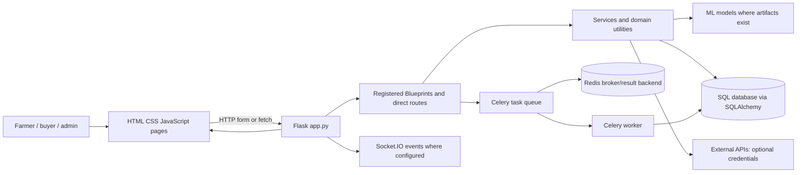
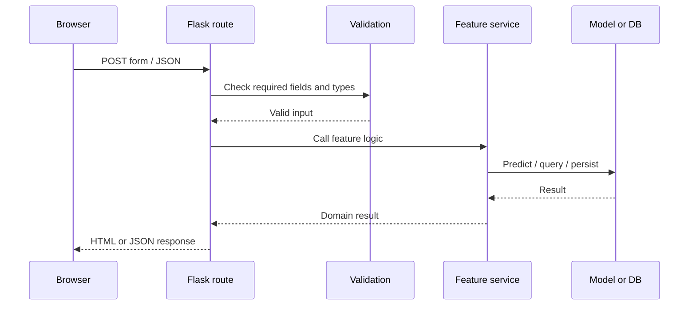
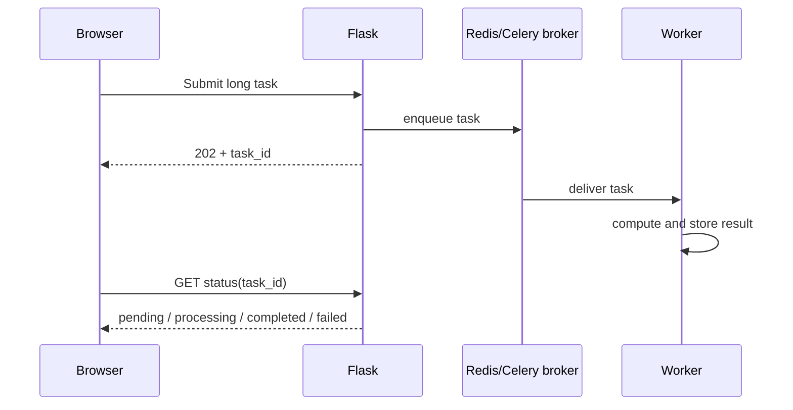

# System Architecture

## Simple picture
A browser page sends a request to Flask. Flask routes it to a feature handler. The handler validates input, calls business logic, may query SQLAlchemy, run a model or call an outside service, then returns HTML/JSON. Long jobs can be sent to Celery through Redis; Socket.IO can deliver live events.

## Frontend
The primary UI is multi-page HTML/CSS/JS, not a detected React SPA. Pages serve as entry points; JavaScript handles interactions and fetches where implemented. Root static serving and Flask rendering coexist. `templates/` is a Flask template folder, while many pages live at repository root.

## Backend and API design
`app.py` initializes Flask, loads configuration, initializes extensions, registers direct handlers and Blueprints, then starts Socket.IO. API v1 is a parent Blueprint with many feature Blueprints. Smaller modules isolate routes by domain. Some domain services may also be imported by separate pages or services. The project has both synchronous form routes and JSON API routes.

## Database
Flask-SQLAlchemy maps Python model classes to relational tables. Flask-Migrate records schema evolution. Development defaults to SQLite; environment configuration can use a different database. `db.create_all()` is called at startup in `app.py`, while migrations also exist; deployment practices should choose a controlled migration flow. Model inventory is in `06_Database_Documentation.md`.

## Integrations and deployment dependencies
Gemini, Firebase, SMTP, weather, FX, translation, S3, Redis and messaging settings are configurable. A credential name in `.env.example` means a possible integration, not a successful connection. Docker Compose includes Flask, Redis, MailHog and Celery worker. Production WSGI/hosting setup was not verified in repository configuration.

## Example synchronous sequence

## Async sequence

