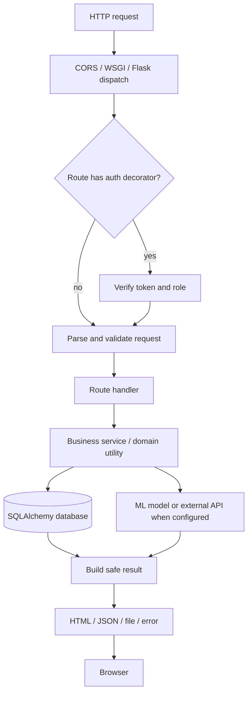

# Backend Documentation

## Startup
`app.py` loads `.env`, imports extension and feature modules, builds the Flask app, applies a selected config, sets upload storage, initializes SQLAlchemy, migrations, mail and limiter, configures Celery and audit middleware, imports models, configures CORS, registers Blueprints, initializes Socket.IO, cache and Babel, creates tables in app context, then configures Gemini. Note: startup currently raises if `GEMINI_API_KEY` is absent outside testing; this is an operational coupling to an external key and should be considered when running locally.

## Layers
- Routes/controllers: Flask route functions and Blueprint modules accept HTTP requests and choose response codes/forms.
- Validation/schemas: Marshmallow schemas and validation utilities check incoming data; coverage varies.
- Services/domain logic: `backend/services/`, `agri_utils.py`, `server/Routes/`, and feature packages implement actions.
- Models: `backend/models/` defines ORM entities.
- Middleware: audit, CORS, rate limiting and auth decorators.
- Async/realtime: Celery tasks and Socket.IO event handlers.

## Main direct routes
`app.py` directly defines page-serving routes, Firebase config, task status, async crop, fertilizer, loan/report endpoints, yield prediction, reset-password/static catch-all, rotation alias and error handlers. See complete decorator appendix in `08_API_Documentation.md`.

## API families
`backend/api/v1/__init__.py` registers a large set of versioned APIs for auth, tasks, assets/files, forum, pools, market, risk, schemes, weather, traceability, disease, insurance, farm, advisory, sustainability, procurement, irrigation, soil, climate, labor, logistics, audit, finance, carbon, warehouse and more. API v1 itself is mounted by `backend/api/__init__.py`. Endpoint specifics remain in each route module.

## Request and response lifecycle

## Validation, errors and logging
Some routes perform manual required-field and range checks; schemas/utilities exist elsewhere. Flask has global 404 handling and logging. Error handling is not uniform: several routes catch broad exceptions and return message text. Production should avoid exposing exception details. Transactions should rollback after DB failures.

## Uploads and storage
An upload folder is configured by `app.py`; config supports local/S3 settings. File API and ingestion Blueprints exist. Confirm each endpoint’s limits, safe filename handling, authorization, content validation and ownership check before claiming secure upload behavior.

## Feature flags and disabled paths
`FeatureFlags` fields exist, but source search found no callers reading them. Their environment values do not currently appear to gate routes. The old disease import path referenced in a commented line does not exist; disease APIs are registered via API v1. Crop inference can be unavailable if its model/encoder artifacts are absent.
