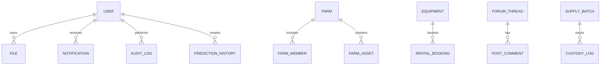

# Database Documentation

## Technology and connection

Flask-SQLAlchemy is the ORM; Flask-Migrate/Alembic handles schema revisions. `backend/config/settings.py` defaults to SQLite for development and reads `DATABASE_URL`/`DEV_DATABASE_URL`. The active environment may override this. The repository also contains `instance/AgroZen_dev.db`; documentation does not inspect or disclose user data.

## How ORM persistence works

A route or service queries model classes, constructs/updates objects, calls `db.session.add`, then `commit`. A failed transaction should call `rollback`. SQLAlchemy generates parameterized SQL. Migrations should be applied deliberately in deployments; `db.create_all()` at application startup does not replace schema migration management.

## Models and schema

The following per-model inventory is extracted from direct `db.Column` declarations in `backend/models/`. Relationships, inherited fields, constraints, indexes and migration-only details are not fully inferable from that summary; inspect each source and migration.

## SQLAlchemy model inventory extracted from `backend/models/`

Fields below are the declarations found on model classes; inherited fields, relationships, constraints, runtime migrations and dynamically created columns may not appear. See each source file for authoritative definitions.

### `CropDiagnosticReport` (table `CropDiagnosticReport`)

- Source: `backend/models/ai_diagnostics.py`
- Declared columns: `id (db.Integer)`, `farm_id (db.Integer)`, `user_id (db.Integer)`, `image_url (db.String(512))`, `identified_pathogen (db.String(100))`, `confidence_score (db.Float)`, `severity_index (db.Float)`, `recommended_treatment (db.Text)`, `estimated_yield_loss_pct (db.Float)`, `status (db.String(20))`, `created_at (db.DateTime)`

### `DiagnosticVerification` (table `DiagnosticVerification`)

- Source: `backend/models/ai_diagnostics.py`
- Declared columns: `id (db.Integer)`, `report_id (db.Integer)`, `expert_id (db.Integer)`, `ai_was_correct (db.Boolean)`, `expert_notes (db.Text)`, `verified_at (db.DateTime)`

### `PathogenKnowledgeBase` (table `PathogenKnowledgeBase`)

- Source: `backend/models/ai_diagnostics.py`
- Declared columns: `id (db.Integer)`, `pathogen_name (db.String(100))`, `typical_symptoms (db.Text)`, `suggested_chemical_treatment (db.Text)`, `organic_alternative (db.Text)`, `mortality_rate_potential (db.Float)`

### `Alert` (table `Alert`)

- Source: `backend/models/alert.py`
- Declared columns: `id (db.Integer)`, `user_id (db.Integer)`, `title (db.String(255))`, `message (db.Text)`, `priority (db.String(20))`, `category (db.String(50))`, `group_key (db.String(100))`, `websocket_delivered (db.Boolean)`, `email_delivered (db.Boolean)`, `sms_delivered (db.Boolean)`, `push_delivered (db.Boolean)`, `expires_at (db.DateTime)`, `read_at (db.DateTime)`, `created_at (db.DateTime)`, `action_url (db.String(512))`, `metadata_json (db.Text)`

### `AlertPreference` (table `AlertPreference`)

- Source: `backend/models/alert.py`
- Declared columns: `id (db.Integer)`, `user_id (db.Integer)`, `category (db.String(50))`, `email_enabled (db.Boolean)`, `sms_enabled (db.Boolean)`, `push_enabled (db.Boolean)`, `websocket_enabled (db.Boolean)`, `min_priority (db.String(20))`

### `ArbitrageOpportunity` (table `ArbitrageOpportunity`)

- Source: `backend/models/arbitrage.py`
- Declared columns: `id (db.Integer)`, `commodity_type (db.String(100))`, `source_grid_id (db.Integer)`, `source_price_per_kg (db.Float)`, `target_grid_id (db.Integer)`, `target_price_per_kg (db.Float)`, `estimated_transport_cost_usd (db.Float)`, `carbon_tax_offset_usd (db.Float)`, `gross_margin_pct (db.Float)`, `net_arbitrage_profit (db.Float)`, `confidence_score (db.Float)`, `status (db.String(20))`, `discovered_at (db.DateTime)`, `expires_at (db.DateTime)`

### `AlgorithmicTradeRecord` (table `AlgorithmicTradeRecord`)

- Source: `backend/models/arbitrage.py`
- Declared columns: `id (db.Integer)`, `opportunity_id (db.Integer)`, `execution_volume_kg (db.Float)`, `actual_buy_price (db.Float)`, `actual_sell_price (db.Float)`, `actual_transport_cost (db.Float)`, `realized_profit_usd (db.Float)`, `slippage_pct (db.Float)`, `ledger_txn_id (db.Integer)`, `executed_at (db.DateTime)`, `settled_at (db.DateTime)`

### `AuditLog` (table `AuditLog`)

- Source: `backend/models/audit_log.py`
- Declared columns: `id (db.Integer)`, `user_id (db.Integer)`, `action (db.String(255))`, `resource_type (db.String(100))`, `resource_id (db.String(100))`, `old_values (db.Text)`, `new_values (db.Text)`, `ip_address (db.String(45))`, `user_agent (db.String(512))`, `method (db.String(10))`, `url (db.String(1024))`, `status_code (db.Integer)`, `risk_level (db.String(20))`, `threat_flag (db.Boolean)`, `is_financial (db.Boolean)`, `financial_impact (db.Float)`, `autonomous_decision_flag (db.Boolean)`, `ai_logistics_flag (db.Boolean)`, `irrigation_auto_flag (db.Boolean)`, `nutrient_optimization_flag (db.Boolean)`, `timestamp (db.DateTime)`, `meta_data (db.Text)`

### `UserSession` (table `UserSession`)

- Source: `backend/models/audit_log.py`
- Declared columns: `id (db.Integer)`, `user_id (db.Integer)`, `session_token (db.String(255))`, `ip_address (db.String(45))`, `user_agent (db.String(512))`, `login_time (db.DateTime)`, `last_activity (db.DateTime)`, `logout_time (db.DateTime)`, `is_active (db.Boolean)`

### `SmartContractOrder` (table `SmartContractOrder`)

- Source: `backend/models/autonomous_supply.py`
- Declared columns: `id (db.Integer)`, `buyer_id (db.Integer)`, `vendor_id (db.Integer)`, `commodity (db.String(100))`, `quantity_kg (db.Float)`, `strike_price_usd (db.Float)`, `auto_execute_at_price (db.Float)`, `status (db.String(30))`, `freight_locked_id (db.Integer)`, `created_at (db.DateTime)`

### `FreightGeoFence` (table `FreightGeoFence`)

- Source: `backend/models/autonomous_supply.py`
- Declared columns: `id (db.Integer)`, `order_id (db.Integer)`, `target_lat (db.Float)`, `target_lng (db.Float)`, `radius_meters (db.Float)`, `current_lat (db.Float)`, `current_lng (db.Float)`, `is_triggered (db.Boolean)`, `triggered_at (db.DateTime)`

### `BarterTransaction` (table `BarterTransaction`)

- Source: `backend/models/barter.py`
- Declared columns: `id (db.Integer)`, `initiator_id (db.Integer)`, `responder_id (db.Integer)`, `status (db.String(20))`, `initiator_committed (db.Boolean)`, `responder_committed (db.Boolean)`, `initiator_confirmed_fulfillment (db.Boolean)`, `responder_confirmed_fulfillment (db.Boolean)`, `value_index_context (db.Text)`, `created_at (db.DateTime)`, `updated_at (db.DateTime)`

### `BarterResource` (table `BarterResource`)

- Source: `backend/models/barter.py`
- Declared columns: `id (db.Integer)`, `transaction_id (db.Integer)`, `provider_id (db.Integer)`, `resource_category (db.String(50))`, `resource_reference_id (db.Integer)`, `resource_name (db.String(100))`, `quantity (db.Float)`, `unit (db.String(20))`, `unit_value_index (db.Float)`, `total_value_index (db.Float)`

### `ResourceValueIndex` (table `ResourceValueIndex`)

- Source: `backend/models/barter.py`
- Declared columns: `id (db.Integer)`, `category (db.String(50))`, `item_name (db.String(100))`, `current_value (db.Float)`, `demand_multiplier (db.Float)`, `last_updated (db.DateTime)`

### `BiomassStockpile` (table `BiomassStockpile`)

- Source: `backend/models/biomass.py`
- Declared columns: `id (db.Integer)`, `farm_id (db.Integer)`, `stockpile_type (db.String(50))`, `total_mass_kg (db.Float)`, `moisture_content_pct (db.Float)`, `calorific_value_mj_per_kg (db.Float)`, `is_fermenting (db.Boolean)`, `methane_yield_potential_m3 (db.Float)`, `last_updated (db.DateTime)`

### `BiogasDigesterLog` (table `BiogasDigesterLog`)

- Source: `backend/models/biomass.py`
- Declared columns: `id (db.Integer)`, `farm_id (db.Integer)`, `stockpile_id (db.Integer)`, `mass_consumed_kg (db.Float)`, `digestion_temp_c (db.Float)`, `ph_level (db.Float)`, `methane_produced_m3 (db.Float)`, `electricity_generated_kwh (db.Float)`, `status (db.String(20))`, `start_time (db.DateTime)`, `end_time (db.DateTime)`

### `CarbonTradeEscrow` (table `CarbonTradeEscrow`)

- Source: `backend/models/carbon_escrow.py`
- Declared columns: `id (db.Integer)`, `seller_id (db.Integer)`, `buyer_id (db.Integer)`, `credits_volume (db.Float)`, `price_per_credit_usd (db.Float)`, `total_value_usd (db.Float)`, `status (db.String(20))`, `verification_proof_hash (db.String(128))`, `created_at (db.DateTime)`, `expires_at (db.DateTime)`, `ledger_txn_id (db.Integer)`

### `EscrowAuditLog` (table `EscrowAuditLog`)

- Source: `backend/models/carbon_escrow.py`
- Declared columns: `id (db.Integer)`, `escrow_id (db.Integer)`, `action (db.String(50))`, `actor_id (db.Integer)`, `details (db.Text)`, `timestamp (db.DateTime)`

### `CarbonCreditWallet` (table `CarbonCreditWallet`)

- Source: `backend/models/carbon_escrow.py`
- Declared columns: `id (db.Integer)`, `user_id (db.Integer)`, `total_credits_minted (db.Float)`, `available_credits_for_sale (db.Float)`, `frozen_credits_in_escrow (db.Float)`, `last_rebalancing_at (db.DateTime)`

### `WasteInventory` (table `WasteInventory`)

- Source: `backend/models/circular.py`
- Declared columns: `id (db.Integer)`, `farm_id (db.Integer)`, `waste_type (db.String(100))`, `quantity_kg (db.Float)`, `status (db.String(50))`, `batch_source_id (db.Integer)`, `is_reused_on_farm (db.Boolean)`, `created_at (db.DateTime)`, `transformed_at (db.DateTime)`

### `BioEnergyOutput` (table `BioEnergyOutput`)

- Source: `backend/models/circular.py`
- Declared columns: `id (db.Integer)`, `farm_id (db.Integer)`, `waste_id (db.Integer)`, `energy_type (db.String(50))`, `amount_kwh (db.Float)`, `efficiency_ratio (db.Float)`, `carbon_offset_kg (db.Float)`, `timestamp (db.DateTime)`

### `CircularCredit` (table `CircularCredit`)

- Source: `backend/models/circular.py`
- Declared columns: `id (db.Integer)`, `user_id (db.Integer)`, `farm_id (db.Integer)`, `credit_amount (db.Float)`, `source_type (db.String(50))`, `audit_chain_hash (db.String(64))`, `created_at (db.DateTime)`, `expires_at (db.DateTime)`

### `ClimateZone` (table `ClimateZone`)

- Source: `backend/models/climate.py`
- Declared columns: `id (db.Integer)`, `farm_id (db.Integer)`, `name (db.String(100))`, `description (db.Text)`, `target_temp_min (db.Float)`, `target_temp_max (db.Float)`, `target_humidity_min (db.Float)`, `target_humidity_max (db.Float)`, `target_co2 (db.Float)`, `created_at (db.DateTime)`

### `SensorNode` (table `SensorNode`)

- Source: `backend/models/climate.py`
- Declared columns: `id (db.Integer)`, `zone_id (db.Integer)`, `uid (db.String(50))`, `node_type (db.String(50))`, `firmware_version (db.String(20))`, `is_active (db.Boolean)`, `last_heartbeat (db.DateTime)`, `created_at (db.DateTime)`

### `TelemetryLog` (table `TelemetryLog`)

- Source: `backend/models/climate.py`
- Declared columns: `id (db.LongInteger if hasattr(db, 'LongInteger') else db.Integer)`, `node_id (db.Integer)`, `temperature (db.Float)`, `humidity (db.Float)`, `co2_level (db.Float)`, `light_intensity (db.Float)`, `soil_moisture (db.Float)`, `soil_ph (db.Float)`, `battery_level (db.Float)`, `signal_strength (db.Float)`, `timestamp (db.DateTime)`

### `AutomationTrigger` (table `AutomationTrigger`)

- Source: `backend/models/climate.py`
- Declared columns: `id (db.Integer)`, `zone_id (db.Integer)`, `name (db.String(100))`, `actor_type (db.String(50))`, `condition_json (db.Text)`, `action_json (db.Text)`, `is_enabled (db.Boolean)`, `last_triggered (db.DateTime)`, `created_at (db.DateTime)`

### `MigrationVector` (table `MigrationVector`)

- Source: `backend/models/disease.py`
- Declared columns: `id (db.Integer)`, `outbreak_zone_id (db.Integer)`, `origin_lat (db.Float)`, `origin_lng (db.Float)`, `target_lat (db.Float)`, `target_lng (db.Float)`, `direction_degrees (db.Float)`, `speed_km_per_day (db.Float)`, `intensity_index (db.Float)`, `wind_influence_factor (db.Float)`, `humidity_breeding_coeff (db.Float)`, `predicted_arrival_time (db.DateTime)`, `created_at (db.DateTime)`

### `ContainmentZone` (table `ContainmentZone`)

- Source: `backend/models/disease.py`
- Declared columns: `id (db.Integer)`, `zone_name (db.String(100))`, `center_lat (db.Float)`, `center_lng (db.Float)`, `radius_meters (db.Float)`, `enforcement_level (db.String(20))`, `irrigation_shutdown_triggered (db.Boolean)`, `logistics_blockade_active (db.Boolean)`, `quarantine_start (db.DateTime)`, `quarantine_end (db.DateTime)`

### `DecentralizedEnergyGrid` (table `DecentralizedEnergyGrid`)

- Source: `backend/models/energy_grid.py`
- Declared columns: `id (db.Integer)`, `grid_name (db.String(100))`, `region_code (db.String(50))`, `target_capacity_mwh (db.Float)`, `current_active_load_mwh (db.Float)`, `current_supply_mwh (db.Float)`, `dynamic_feed_in_tariff_usd (db.Float)`, `status (db.String(20))`, `last_rebalancing (db.DateTime)`

### `EnergyTokenMint` (table `EnergyTokenMint`)

- Source: `backend/models/energy_grid.py`
- Declared columns: `id (db.Integer)`, `token_hash (db.String(64))`, `farm_id (db.Integer)`, `grid_id (db.Integer)`, `digester_log_id (db.Integer)`, `energy_mwh (db.Float)`, `mint_price_usd (db.Float)`, `ledger_txn_id (db.Integer)`, `status (db.String(20))`, `minted_at (db.DateTime)`

### `GridInjectionLog` (table `GridInjectionLog`)

- Source: `backend/models/energy_grid.py`
- Declared columns: `id (db.Integer)`, `farm_id (db.Integer)`, `grid_id (db.Integer)`, `kwh_injected (db.Float)`, `voltage_v (db.Float)`, `frequency_hz (db.Float)`, `recorded_at (db.DateTime)`

### `Equipment` (table `Equipment`)

- Source: `backend/models/equipment.py`
- Declared columns: `id (db.Integer)`, `owner_id (db.Integer)`, `name (db.String(100))`, `category (db.String(50))`, `description (db.Text)`, `hourly_rate (db.Float)`, `daily_rate (db.Float)`, `location (db.String(255))`, `image_url (db.String(255))`, `specifications (db.Text)`, `is_available (db.Boolean)`, `created_at (db.DateTime)`, `reliability_score (db.Float)`, `vibration_level (db.Float)`, `heat_index (db.Float)`, `duty_cycle_rating (db.Float)`, `last_health_check (db.DateTime)`

### `RentalBooking` (table `RentalBooking`)

- Source: `backend/models/equipment.py`
- Declared columns: `id (db.Integer)`, `equipment_id (db.Integer)`, `renter_id (db.Integer)`, `start_time (db.DateTime)`, `end_time (db.DateTime)`, `total_price (db.Float)`, `security_deposit (db.Float)`, `status (db.String(20))`, `payment_intent_id (db.String(100))`, `created_at (db.DateTime)`

### `AvailabilityCalendar` (table `AvailabilityCalendar`)

- Source: `backend/models/equipment.py`
- Declared columns: `id (db.Integer)`, `equipment_id (db.Integer)`, `date (db.Date)`, `is_blocked (db.Boolean)`, `reason (db.String(100))`

### `PaymentEscrow` (table `PaymentEscrow`)

- Source: `backend/models/equipment.py`
- Declared columns: `id (db.Integer)`, `booking_id (db.Integer)`, `total_amount (db.Float)`, `held_at (db.DateTime)`, `status (db.String(20))`, `released_at (db.DateTime)`, `dispute_reason (db.Text)`, `transaction_ref (db.String(100))`

### `Farm` (table `Farm`)

- Source: `backend/models/farm.py`
- Declared columns: `id (db.Integer)`, `name (db.String(100))`, `description (db.Text)`, `location (db.String(255))`, `acreage (db.Float)`, `soil_details (db.Text)`, `harvest_readiness_index (db.Float)`, `predicted_yield_volume (db.Float)`, `last_velocity_update (db.DateTime)`, `is_no_till (db.Boolean)`, `cover_crop_active (db.Boolean)`, `organic_certified (db.Boolean)`, `sequestration_tier (db.String(20))`, `total_carbon_credits_minted (db.Float)`, `spatial_grid_id (db.Integer)`, `created_at (db.DateTime)`

### `FarmMember` (table `FarmMember`)

- Source: `backend/models/farm.py`
- Declared columns: `id (db.Integer)`, `farm_id (db.Integer)`, `user_id (db.Integer)`, `role (db.String(20))`, `joined_at (db.DateTime)`, `invited_by_id (db.Integer)`

### `FarmAsset` (table `FarmAsset`)

- Source: `backend/models/farm.py`
- Declared columns: `id (db.Integer)`, `farm_id (db.Integer)`, `asset_id (db.String(64))`, `user_id (db.Integer)`, `asset_type (db.String(100))`, `asset_name (db.String(200))`, `manufacturer (db.String(100))`, `model (db.String(100))`, `serial_number (db.String(100))`, `purchase_price (db.Float)`, `status (db.String(30))`, `health_score (db.Float)`, `alert_threshold_days (db.Integer)`, `total_runtime_hours (db.Float)`, `last_telemetry (db.Text)`, `predicted_days_to_failure (db.Integer)`, `last_maintenance_date (db.DateTime)`, `next_maintenance_due (db.DateTime)`, `name (db.String(100))`, `category (db.String(50))`, `purchase_value (db.Float)`, `purchase_date (db.DateTime)`, `condition (db.String(50))`, `last_maintenance (db.DateTime)`, `current_valuation (db.Float)`, `created_at (db.DateTime)`

### `MaintenanceLog` (table `MaintenanceLog`)

- Source: `backend/models/farm.py`
- Declared columns: `id (db.Integer)`, `log_id (db.String(80))`, `asset_id (db.Integer)`, `maintenance_type (db.String(30))`, `description (db.Text)`, `parts_replaced (db.Text)`, `cost (db.Float)`, `pre_maintenance_health (db.Float)`, `post_maintenance_health (db.Float)`, `technician_name (db.String(200))`, `technician_notes (db.Text)`, `scheduled_date (db.DateTime)`, `completed_date (db.DateTime)`, `status (db.String(30))`, `created_at (db.DateTime)`

### `FieldMicronutrients` (table `FieldMicronutrients`)

- Source: `backend/models/fertigation_v2.py`
- Declared columns: `id (db.Integer)`, `farm_id (db.Integer)`, `zone_id (db.Integer)`, `zinc (db.Float)`, `iron (db.Float)`, `boron (db.Float)`, `manganese (db.Float)`, `copper (db.Float)`, `microbial_activity_index (db.Float)`, `nutrient_availability_score (db.Float)`, `recorded_at (db.DateTime)`

### `NutrientInjectionLog` (table `NutrientInjectionLog`)

- Source: `backend/models/fertigation_v2.py`
- Declared columns: `id (db.Integer)`, `zone_id (db.Integer)`, `nitrogen_content_pct (db.Float)`, `phosphorus_content_pct (db.Float)`, `potassium_content_pct (db.Float)`, `sulfur_content_pct (db.Float)`, `total_injected_volume_l (db.Float)`, `autonomous_trigger_code (db.String(50))`, `predicted_runoff_loss_pct (db.Float)`, `recorded_at (db.DateTime)`

### `FarmBalanceSheet` (table `FarmBalanceSheet`)

- Source: `backend/models/financials.py`
- Declared columns: `id (db.Integer)`, `farm_id (db.Integer)`, `cash_on_hand (db.Float)`, `inventory_value (db.Float)`, `fixed_assets_value (db.Float)`, `outstanding_loans (db.Float)`, `accounts_payable (db.Float)`, `net_worth (db.Float)`, `period_date (db.Date)`, `created_at (db.DateTime)`

### `ProfitabilityIndex` (table `ProfitabilityIndex`)

- Source: `backend/models/financials.py`
- Declared columns: `id (db.Integer)`, `farm_id (db.Integer)`, `roi_machinery (db.Float)`, `roi_labor (db.Float)`, `yield_efficiency (db.Float)`, `overall_profitability_score (db.Float)`, `calculated_at (db.DateTime)`

### `SolvencySnapshot` (table `SolvencySnapshot`)

- Source: `backend/models/financials.py`
- Declared columns: `id (db.Integer)`, `farm_id (db.Integer)`, `debt_to_equity_ratio (db.Float)`, `liquidity_ratio (db.Float)`, `bankruptcy_risk_score (db.Float)`, `status (db.String(20))`, `next_review_date (db.Date)`, `created_at (db.DateTime)`

### `ForumCategory` (table `ForumCategory`)

- Source: `backend/models/forum.py`
- Declared columns: `id (db.Integer)`, `name (db.String(100))`, `description (db.Text)`, `icon (db.String(50))`, `created_at (db.DateTime)`

### `ForumThread` (table `ForumThread`)

- Source: `backend/models/forum.py`
- Declared columns: `id (db.Integer)`, `category_id (db.Integer)`, `user_id (db.Integer)`, `title (db.String(255))`, `content (db.Text)`, `tags (db.String(255))`, `is_pinned (db.Boolean)`, `is_locked (db.Boolean)`, `is_flagged (db.Boolean)`, `flag_reason (db.String(255))`, `sentiment_score (db.Float)`, `toxicity_score (db.Float)`, `is_ai_approved (db.Boolean)`, `view_count (db.Integer)`, `upvote_count (db.Integer)`, `created_at (db.DateTime)`, `updated_at (db.DateTime)`, `last_activity (db.DateTime)`

### `PostComment` (table `PostComment`)

- Source: `backend/models/forum.py`
- Declared columns: `id (db.Integer)`, `thread_id (db.Integer)`, `user_id (db.Integer)`, `parent_id (db.Integer)`, `content (db.Text)`, `sentiment_score (db.Float)`, `is_ai_approved (db.Boolean)`, `is_ai_generated (db.Boolean)`, `is_flagged (db.Boolean)`, `flag_reason (db.String(255))`, `upvote_count (db.Integer)`, `created_at (db.DateTime)`, `updated_at (db.DateTime)`

### `Upvote` (table `Upvote`)

- Source: `backend/models/forum.py`
- Declared columns: `id (db.Integer)`, `user_id (db.Integer)`, `thread_id (db.Integer)`, `comment_id (db.Integer)`, `created_at (db.DateTime)`

### `UserReputation` (table `UserReputation`)

- Source: `backend/models/forum.py`
- Declared columns: `id (db.Integer)`, `user_id (db.Integer)`, `total_score (db.Integer)`, `threads_created (db.Integer)`, `comments_posted (db.Integer)`, `upvotes_received (db.Integer)`, `helpful_answers (db.Integer)`, `is_expert (db.Boolean)`, `is_moderator (db.Boolean)`, `badges (db.Text)`, `updated_at (db.DateTime)`

### `AutonomousVehicle` (table `AutonomousVehicle`)

- Source: `backend/models/freight_v2.py`
- Declared columns: `id (db.Integer)`, `serial_number (db.String(100))`, `vehicle_type (db.String(50))`, `current_capacity_kg (db.Float)`, `battery_level_pct (db.Float)`, `status (db.String(20))`, `current_lat (db.Float)`, `current_lng (db.Float)`, `last_ping (db.DateTime)`

### `VehicleMission` (table `VehicleMission`)

- Source: `backend/models/freight_v2.py`
- Declared columns: `id (db.Integer)`, `vehicle_id (db.Integer)`, `order_id (db.Integer)`, `assigned_at (db.DateTime)`, `completed_at (db.DateTime)`, `distance_traveled_km (db.Float)`, `energy_consumed_kwh (db.Float)`

### `SeedGenomeProfile` (table `SeedGenomeProfile`)

- Source: `backend/models/genomics.py`
- Declared columns: `id (db.Integer)`, `strain_name (db.String(150))`, `species (db.String(50))`, `drought_tolerance_allele (db.Float)`, `heat_shock_protein_expression (db.Float)`, `pest_resistance_marker (db.Float)`, `yield_vigor_multiplier (db.Float)`, `is_crispr_edited (db.Boolean)`, `original_wild_type_id (db.Integer)`, `generation_num (db.Integer)`, `lab_certification_hash (db.String(128))`, `created_at (db.DateTime)`

### `LiveCropPhenotype` (table `LiveCropPhenotype`)

- Source: `backend/models/genomics.py`
- Declared columns: `id (db.Integer)`, `farm_id (db.Integer)`, `genome_id (db.Integer)`, `expressed_drought_tolerance (db.Float)`, `expressed_heat_shock_resilience (db.Float)`, `expressed_pest_defense (db.Float)`, `epigenetic_stress_factor (db.Float)`, `current_health_score (db.Float)`, `planted_at (db.DateTime)`, `harvested_at (db.DateTime)`, `status (db.String(20))`

### `EpigeneticDriftLog` (table `EpigeneticDriftLog`)

- Source: `backend/models/genomics.py`
- Declared columns: `id (db.Integer)`, `phenotype_id (db.Integer)`, `triggering_event (db.String(100))`, `delta_drought_tolerance (db.Float)`, `delta_stress_factor (db.Float)`, `delta_health_score (db.Float)`, `recorded_at (db.DateTime)`

### `DiseaseIncident` (table `DiseaseIncident`)

- Source: `backend/models/gews.py`
- Declared columns: `id (db.Integer)`, `incident_id (db.String(20))`, `user_id (db.Integer)`, `disease_name (db.String(100))`, `crop_affected (db.String(100))`, `severity_level (db.String(20))`, `symptoms (db.Text)`, `latitude (db.Float)`, `longitude (db.Float)`, `affected_area (db.Float)`, `detection_method (db.String(50))`, `verification_status (db.String(20))`, `reported_at (db.DateTime)`, `outbreak_zone_id (db.Integer)`

### `OutbreakZone` (table `OutbreakZone`)

- Source: `backend/models/gews.py`
- Declared columns: `id (db.Integer)`, `zone_id (db.String(50))`, `disease_name (db.String(100))`, `crop_affected (db.String(100))`, `severity_level (db.String(20))`, `center_latitude (db.Float)`, `center_longitude (db.Float)`, `radius_km (db.Float)`, `incident_count (db.Integer)`, `total_affected_area (db.Float)`, `status (db.String(20))`, `risk_level (db.String(20))`, `propagation_velocity (db.Float)`, `transmission_radius (db.Float)`, `wind_vector_deg (db.Float)`, `soil_connectivity_score (db.Float)`, `containment_status (db.String(30))`, `containment_applied_at (db.DateTime)`, `created_at (db.DateTime)`

### `OutbreakProjection` (table `OutbreakProjection`)

- Source: `backend/models/gews.py`
- Declared columns: `id (db.Integer)`, `outbreak_zone_id (db.Integer)`, `projection_time (db.DateTime)`, `projected_latitude (db.Float)`, `projected_longitude (db.Float)`, `expected_radius (db.Float)`, `confidence_score (db.Float)`, `created_at (db.DateTime)`

### `OutbreakAlert` (table `OutbreakAlert`)

- Source: `backend/models/gews.py`
- Declared columns: `id (db.Integer)`, `alert_id (db.String(50))`, `user_id (db.Integer)`, `zone_id (db.Integer)`, `status (db.String(20))`, `priority (db.String(20))`, `message (db.Text)`, `created_at (db.DateTime)`, `acknowledged_at (db.DateTime)`

### `CustomsManifest` (table `CustomsManifest`)

- Source: `backend/models/global_trade.py`
- Declared columns: `id (db.Integer)`, `order_id (db.Integer)`, `declaration_number (db.String(50))`, `country_of_origin (db.String(50))`, `destination_country (db.String(50))`, `hs_code (db.String(20))`, `total_value_usd (db.Float)`, `status (db.String(20))`, `rejection_reason (db.Text)`, `created_at (db.DateTime)`, `cleared_at (db.DateTime)`, `phyto_cert_url (db.String(255))`, `commercial_invoice_url (db.String(255))`

### `ComplianceCheck` (table `ComplianceCheck`)

- Source: `backend/models/global_trade.py`
- Declared columns: `id (db.Integer)`, `manifest_id (db.Integer)`, `batch_id (db.Integer)`, `check_type (db.String(50))`, `passed (db.Boolean)`, `score (db.Float)`, `details (db.Text)`, `timestamp (db.DateTime)`

### `GovernmentScheme` (table `GovernmentScheme`)

- Source: `backend/models/government_schemes.py`
- Declared columns: `id (db.Integer)`, `scheme_code (db.String(50))`, `name (db.String(200))`, `ministry (db.String(150))`, `description (db.Text)`, `farm_size_min (db.Float)`, `farm_size_max (db.Float)`, `income_limit (db.Float)`, `required_crops (db.Text)`, `region_specific (db.Boolean)`, `eligible_states (db.Text)`, `subsidy_percentage (db.Float)`, `max_subsidy_amount (db.Float)`, `application_fee (db.Float)`, `application_start_date (db.Date)`, `application_deadline (db.Date)`, `is_active (db.Boolean)`, `required_documents (db.Text)`, `created_at (db.DateTime)`, `updated_at (db.DateTime)`

### `SchemeApplication` (table `SchemeApplication`)

- Source: `backend/models/government_schemes.py`
- Declared columns: `id (db.Integer)`, `scheme_id (db.Integer)`, `user_id (db.Integer)`, `farm_id (db.Integer)`, `application_number (db.String(50))`, `status (db.String(20))`, `eligibility_score (db.Float)`, `eligibility_notes (db.Text)`, `farmer_details (db.Text)`, `farm_details (db.Text)`, `income_proof (db.Text)`, `submitted_documents (db.Text)`, `documents_verified (db.Boolean)`, `assistance_notes (db.Text)`, `assistance_contact (db.String(100))`, `submitted_at (db.DateTime)`, `reviewed_at (db.DateTime)`, `approved_at (db.DateTime)`, `rejection_reason (db.Text)`, `created_at (db.DateTime)`, `updated_at (db.DateTime)`

### `SchemeReminder` (table `SchemeReminder`)

- Source: `backend/models/government_schemes.py`
- Declared columns: `id (db.Integer)`, `scheme_id (db.Integer)`, `user_id (db.Integer)`, `reminder_type (db.String(30))`, `reminder_date (db.DateTime)`, `message (db.Text)`, `is_sent (db.Boolean)`, `sent_at (db.DateTime)`, `created_at (db.DateTime)`

### `InsurancePolicy` (table `InsurancePolicy`)

- Source: `backend/models/insurance.py`
- Declared columns: `id (db.Integer)`, `user_id (db.Integer)`, `policy_number (db.String(50))`, `coverage_amount (db.Numeric(15, 2))`, `premium_amount (db.Numeric(15, 2))`, `ars_score_at_issuance (db.Float)`, `risk_multiplier (db.Float)`, `crop_type (db.String(100))`, `farm_location (db.String(200))`, `farm_size_acres (db.Float)`, `issue_date (db.DateTime)`, `start_date (db.DateTime)`, `end_date (db.DateTime)`, `status (db.String(20))`, `notes (db.Text)`, `created_at (db.DateTime)`, `current_risk_score (db.Float)`, `is_suspended (db.Boolean)`, `suspension_reason (db.String(255))`, `recursive_discount_applied (db.Boolean)`, `force_majeure_review (db.Boolean)`

### `DynamicPremiumLog` (table `DynamicPremiumLog`)

- Source: `backend/models/insurance.py`
- Declared columns: `id (db.Integer)`, `policy_id (db.Integer)`, `old_premium (db.Numeric(15, 2))`, `new_premium (db.Numeric(15, 2))`, `change_reason (db.String(255))`, `triggered_by (db.String(50))`, `timestamp (db.DateTime)`

### `RiskFactorSnapshot` (table `RiskFactorSnapshot`)

- Source: `backend/models/insurance.py`
- Declared columns: `id (db.Integer)`, `policy_id (db.Integer)`, `weather_risk_index (db.Float)`, `telemetry_risk_index (db.Float)`, `sustainability_discount_factor (db.Float)`, `recorded_at (db.DateTime)`

### `ClaimRequest` (table `ClaimRequest`)

- Source: `backend/models/insurance.py`
- Declared columns: `id (db.Integer)`, `policy_id (db.Integer)`, `user_id (db.Integer)`, `claim_number (db.String(50))`, `claimed_amount (db.Numeric(15, 2))`, `approved_amount (db.Numeric(15, 2))`, `incident_date (db.DateTime)`, `incident_description (db.Text)`, `evidence_photos (db.JSON)`, `status (db.String(20))`, `ai_verification_status (db.String(20))`, `rejection_reason (db.Text)`, `processed_at (db.DateTime)`, `payment_date (db.DateTime)`, `notes (db.Text)`, `created_at (db.DateTime)`

### `RiskScoreHistory` (table `RiskScoreHistory`)

- Source: `backend/models/insurance.py`
- Declared columns: `id (db.Integer)`, `user_id (db.Integer)`, `ars_score (db.Float)`, `risk_category (db.String(20))`, `calculation_date (db.DateTime)`, `notes (db.Text)`

### `CropPolicy` (table `CropPolicy`)

- Source: `backend/models/insurance_v2.py`
- Declared columns: `id (db.Integer)`, `user_id (db.Integer)`, `farm_id (db.Integer)`, `crop_type (db.String(50))`, `coverage_amount (db.Float)`, `premium_paid (db.Float)`, `start_date (db.Date)`, `end_date (db.Date)`, `risk_score (db.Float)`, `status (db.String(20))`, `parametric_enabled (db.Boolean)`, `yield_at_risk_pct (db.Float)`, `last_climate_check (db.DateTime)`, `created_at (db.DateTime)`

### `ClaimRequest` (table `ClaimRequest`)

- Source: `backend/models/insurance_v2.py`
- Declared columns: `id (db.Integer)`, `policy_id (db.Integer)`, `claim_amount (db.Float)`, `reason (db.Text)`, `evidence_url (db.String(255))`, `status (db.String(20))`, `submitted_at (db.DateTime)`, `processed_at (db.DateTime)`

### `AdjusterNote` (table `AdjusterNote`)

- Source: `backend/models/insurance_v2.py`
- Declared columns: `id (db.Integer)`, `claim_id (db.Integer)`, `adjuster_id (db.Integer)`, `content (db.Text)`, `verification_score (db.Float)`, `created_at (db.DateTime)`

### `PayoutLedger` (table `PayoutLedger`)

- Source: `backend/models/insurance_v2.py`
- Declared columns: `id (db.Integer)`, `claim_id (db.Integer)`, `amount (db.Float)`, `transaction_ref (db.String(100))`, `paid_at (db.DateTime)`

### `ParametricAutoSettlement` (table `ParametricAutoSettlement`)

- Source: `backend/models/insurance_v2.py`
- Declared columns: `id (db.Integer)`, `policy_id (db.Integer)`, `alert_id (db.Integer)`, `coverage_amount (db.Float)`, `payout_percentage (db.Float)`, `payout_amount (db.Float)`, `trigger_type (db.String(50))`, `consecutive_days_observed (db.Integer)`, `peak_temperature_c (db.Float)`, `evidence_hash (db.String(64))`, `ledger_transaction_id (db.Integer)`, `settled_at (db.DateTime)`

### `AssetTelemetry` (table `AssetTelemetry`)

- Source: `backend/models/iot_maintenance.py`
- Declared columns: `id (db.Integer)`, `asset_id (db.Integer)`, `engine_rpm (db.Float)`, `coolant_temp_c (db.Float)`, `vibration_amplitude (db.Float)`, `fuel_pressure_psi (db.Float)`, `cumulative_hours (db.Float)`, `recorded_at (db.DateTime)`

### `MaintenancePrediction` (table `MaintenancePrediction`)

- Source: `backend/models/iot_maintenance.py`
- Declared columns: `id (db.Integer)`, `asset_id (db.Integer)`, `failure_probability (db.Float)`, `estimated_remaining_useful_life_hrs (db.Float)`, `predicted_component_failure (db.String(100))`, `criticality_level (db.String(20))`, `generated_at (db.DateTime)`, `status (db.String(20))`

### `ComponentWearMap` (table `ComponentWearMap`)

- Source: `backend/models/iot_maintenance.py`
- Declared columns: `id (db.Integer)`, `asset_id (db.Integer)`, `component_name (db.String(100))`, `wear_percentage (db.Float)`, `last_inspected_at (db.DateTime)`, `replacement_threshold (db.Float)`

### `IrrigationZone` (table `IrrigationZone`)

- Source: `backend/models/irrigation.py`
- Declared columns: `id (db.Integer)`, `farm_id (db.Integer)`, `name (db.String(100))`, `description (db.Text)`, `moisture_threshold_min (db.Float)`, `moisture_threshold_max (db.Float)`, `current_valve_status (db.String(20))`, `last_activation (db.DateTime)`, `auto_mode (db.Boolean)`, `created_at (db.DateTime)`, `banned_by_system (db.Boolean)`, `fertigation_enabled (db.Boolean)`, `fertigation_valve_status (db.String(20))`, `chemical_concentration (db.Float)`, `washout_risk_threshold (db.Float)`, `total_water_withdrawn (db.Float)`, `electricity_usage_kwh (db.Float)`, `pest_control_mode (db.Boolean)`, `pest_neutralization_active (db.Boolean)`, `target_pest_id (db.Integer)`

### `FertigationLog` (table `FertigationLog`)

- Source: `backend/models/irrigation.py`
- Declared columns: `id (db.Integer)`, `zone_id (db.Integer)`, `injectant_type (db.String(50))`, `concentration_ppm (db.Float)`, `volume_liters (db.Float)`, `washout_risk_score (db.Float)`, `weather_impact_factor (db.Float)`, `timestamp (db.DateTime)`

### `SensorLog` (table `SensorLog`)

- Source: `backend/models/irrigation.py`
- Declared columns: `id (db.Integer)`, `zone_id (db.Integer)`, `moisture (db.Float)`, `temperature (db.Float)`, `ph_level (db.Float)`, `timestamp (db.DateTime)`

### `IrrigationSchedule` (table `IrrigationSchedule`)

- Source: `backend/models/irrigation.py`
- Declared columns: `id (db.Integer)`, `zone_id (db.Integer)`, `start_time (db.Time)`, `duration_minutes (db.Integer)`, `days_of_week (db.String(50))`, `is_active (db.Boolean)`, `last_run (db.DateTime)`

### `AquiferLevel` (table `AquiferLevel`)

- Source: `backend/models/irrigation.py`
- Declared columns: `id (db.Integer)`, `region_name (db.String(100))`, `current_depth_meters (db.Float)`, `depletion_rate (db.Float)`, `last_survey_date (db.DateTime)`

### `WaterRightsQuota` (table `WaterRightsQuota`)

- Source: `backend/models/irrigation.py`
- Declared columns: `id (db.Integer)`, `farm_id (db.Integer)`, `aquifer_id (db.Integer)`, `total_quota_liters (db.Float)`, `used_quota_liters (db.Float)`, `renewal_date (db.DateTime)`, `status (db.String(20))`

### `Question` (table `Question`)

- Source: `backend/models/knowledge.py`
- Declared columns: `id (db.Integer)`, `user_id (db.Integer)`, `title (db.String(255))`, `content (db.Text)`, `category (db.String(50))`, `view_count (db.Integer)`, `upvote_count (db.Integer)`, `answer_count (db.Integer)`, `is_closed (db.Boolean)`, `has_accepted_answer (db.Boolean)`, `created_at (db.DateTime)`, `updated_at (db.DateTime)`

### `Answer` (table `Answer`)

- Source: `backend/models/knowledge.py`
- Declared columns: `id (db.Integer)`, `question_id (db.Integer)`, `user_id (db.Integer)`, `content (db.Text)`, `upvote_count (db.Integer)`, `is_accepted (db.Boolean)`, `created_at (db.DateTime)`, `updated_at (db.DateTime)`

### `KnowledgeVote` (table `KnowledgeVote`)

- Source: `backend/models/knowledge.py`
- Declared columns: `id (db.Integer)`, `user_id (db.Integer)`, `question_id (db.Integer)`, `answer_id (db.Integer)`, `vote_type (db.Integer)`, `created_at (db.DateTime)`

### `Badge` (table `Badge`)

- Source: `backend/models/knowledge.py`
- Declared columns: `id (db.Integer)`, `name (db.String(50))`, `description (db.String(255))`, `icon_url (db.String(255))`, `criteria_json (db.Text)`

### `UserBadge` (table `UserBadge`)

- Source: `backend/models/knowledge.py`
- Declared columns: `id (db.Integer)`, `user_id (db.Integer)`, `badge_id (db.Integer)`, `awarded_at (db.DateTime)`

### `UserExpertise` (table `UserExpertise`)

- Source: `backend/models/knowledge.py`
- Declared columns: `id (db.Integer)`, `user_id (db.Integer)`, `category (db.String(50))`, `is_verified (db.Boolean)`, `verification_doc_url (db.String(255))`, `reputation_score (db.Integer)`, `created_at (db.DateTime)`

### `WorkerProfile` (table `WorkerProfile`)

- Source: `backend/models/labor.py`
- Declared columns: `id (db.Integer)`, `farm_id (db.Integer)`, `name (db.String(150))`, `contact_info (db.String(255))`, `worker_type (db.String(50))`, `base_hourly_rate (db.Float)`, `piece_rate_kg (db.Float)`, `bank_details (db.Text)`, `is_active (db.Boolean)`, `created_at (db.DateTime)`

### `WorkerSkillMap` (table `WorkerSkillMap`)

- Source: `backend/models/labor.py`
- Declared columns: `id (db.Integer)`, `worker_id (db.Integer)`, `skill_name (db.String(100))`, `certification_level (db.String(20))`, `expiry_date (db.Date)`

### `WorkShift` (table `WorkShift`)

- Source: `backend/models/labor.py`
- Declared columns: `id (db.Integer)`, `worker_id (db.Integer)`, `start_time (db.DateTime)`, `end_time (db.DateTime)`, `break_duration (db.Integer)`, `total_hours (db.Float)`, `shift_status (db.String(20))`, `notes (db.Text)`

### `HarvestLog` (table `HarvestLog`)

- Source: `backend/models/labor.py`
- Declared columns: `id (db.Integer)`, `worker_id (db.Integer)`, `crop_type (db.String(100))`, `quantity_kg (db.Float)`, `logged_at (db.DateTime)`, `is_processed (db.Boolean)`, `payroll_id (db.Integer)`

### `PayrollEntry` (table `PayrollEntry`)

- Source: `backend/models/labor.py`
- Declared columns: `id (db.Integer)`, `worker_id (db.Integer)`, `period_start (db.Date)`, `period_end (db.Date)`, `gross_hourly_pay (db.Float)`, `gross_piece_pay (db.Float)`, `overtime_premium (db.Float)`, `bonus_amount (db.Float)`, `tax_deduction (db.Float)`, `advances_deduction (db.Float)`, `net_payable (db.Float)`, `status (db.String(20))`, `payment_ref (db.String(100))`, `processed_at (db.DateTime)`

### `LaborROIHistory` (table `LaborROIHistory`)

- Source: `backend/models/labor.py`
- Declared columns: `id (db.Integer)`, `worker_id (db.Integer)`, `period_start (db.Date)`, `period_end (db.Date)`, `total_hours_worked (db.Float)`, `total_yield_kg (db.Float)`, `labor_cost (db.Float)`, `yield_value_estimate (db.Float)`, `roi_percentage (db.Float)`, `calculated_at (db.DateTime)`

### `LedgerAccount` (table `LedgerAccount`)

- Source: `backend/models/ledger.py`
- Declared columns: `id (db.Integer)`, `account_code (db.String(20))`, `name (db.String(100))`, `account_type (db.Enum(AccountType))`, `currency (db.String(3))`, `parent_id (db.Integer)`, `entity_type (db.String(50))`, `entity_id (db.Integer)`, `is_active (db.Boolean)`, `is_system (db.Boolean)`, `description (db.Text)`, `created_at (db.DateTime)`, `updated_at (db.DateTime)`

### `LedgerTransaction` (table `LedgerTransaction`)

- Source: `backend/models/ledger.py`
- Declared columns: `id (db.Integer)`, `transaction_id (db.String(36))`, `transaction_type (db.Enum(TransactionType))`, `source_type (db.String(50))`, `source_id (db.Integer)`, `description (db.Text)`, `reference_number (db.String(100))`, `base_currency (db.String(3))`, `base_amount (db.Numeric(18, 6))`, `fx_rate_used (db.Numeric(18, 8))`, `fx_rate_date (db.DateTime)`, `created_by (db.Integer)`, `created_at (db.DateTime)`, `is_reversed (db.Boolean)`, `reversed_by_id (db.Integer)`

### `LedgerEntry` (table `LedgerEntry`)

- Source: `backend/models/ledger.py`
- Declared columns: `id (db.Integer)`, `transaction_id (db.Integer)`, `account_id (db.Integer)`, `entry_type (db.Enum(EntryType))`, `amount (db.Numeric(18, 6))`, `currency (db.String(3))`, `base_amount (db.Numeric(18, 6))`, `base_currency (db.String(3))`, `fx_rate (db.Numeric(18, 8))`, `entry_date (db.DateTime)`, `memo (db.String(500))`, `metadata_json (db.JSON)`, `created_at (db.DateTime)`

### `FXValuationSnapshot` (table `FXValuationSnapshot`)

- Source: `backend/models/ledger.py`
- Declared columns: `id (db.Integer)`, `entity_type (db.String(50))`, `entity_id (db.Integer)`, `snapshot_date (db.DateTime)`, `currency (db.String(3))`, `position_amount (db.Numeric(18, 6))`, `original_fx_rate (db.Numeric(18, 8))`, `current_fx_rate (db.Numeric(18, 8))`, `base_currency (db.String(3))`, `original_base_value (db.Numeric(18, 6))`, `current_base_value (db.Numeric(18, 6))`, `unrealized_gain_loss (db.Numeric(18, 6))`, `unrealized_gain_loss_pct (db.Numeric(10, 4))`, `period_start (db.DateTime)`, `period_end (db.DateTime)`, `cumulative_realized_gain (db.Numeric(18, 6))`, `cumulative_unrealized_gain (db.Numeric(18, 6))`, `created_at (db.DateTime)`

### `Vault` (table `Vault`)

- Source: `backend/models/ledger.py`
- Declared columns: `id (db.Integer)`, `vault_id (db.String(36))`, `name (db.String(100))`, `owner_type (db.String(50))`, `owner_id (db.Integer)`, `base_currency (db.String(3))`, `ledger_account_id (db.Integer)`, `allow_multi_currency (db.Boolean)`, `auto_fx_revaluation (db.Boolean)`, `is_active (db.Boolean)`, `is_locked (db.Boolean)`, `locked_reason (db.String(200))`, `created_at (db.DateTime)`, `updated_at (db.DateTime)`

### `VaultCurrencyPosition` (table `VaultCurrencyPosition`)

- Source: `backend/models/ledger.py`
- Declared columns: `id (db.Integer)`, `vault_id (db.Integer)`, `currency (db.String(3))`, `ledger_account_id (db.Integer)`, `cost_basis_rate (db.Numeric(18, 8))`, `cost_basis_amount (db.Numeric(18, 6))`, `last_fx_rate (db.Numeric(18, 8))`, `last_revaluation_date (db.DateTime)`, `cumulative_realized_fx_gain (db.Numeric(18, 6))`, `cumulative_unrealized_fx_gain (db.Numeric(18, 6))`, `created_at (db.DateTime)`, `updated_at (db.DateTime)`

### `FXRate` (table `FXRate`)

- Source: `backend/models/ledger.py`
- Declared columns: `id (db.Integer)`, `from_currency (db.String(3))`, `to_currency (db.String(3))`, `rate (db.Numeric(18, 8))`, `rate_date (db.Date)`, `rate_time (db.DateTime)`, `source (db.String(50))`, `is_current (db.Boolean)`, `created_at (db.DateTime)`

### `LoanRequest` (table `LoanRequest`)

- Source: `backend/models/loan_request.py`
- Declared columns: `id (db.Integer)`, `user_id (db.Integer)`, `loan_type (db.String(100))`, `amount_requested (db.Float)`, `purpose (db.Text)`, `applicant_data (db.Text)`, `eligibility_status (db.String(20))`, `assessment_result (db.Text)`, `recommended_amount (db.Float)`, `risk_score (db.Float)`, `status (db.String(20))`, `submitted_at (db.DateTime)`, `processed_at (db.DateTime)`, `created_at (db.DateTime)`, `updated_at (db.DateTime)`, `report_generated (db.Boolean)`, `report_path (db.String(255))`, `report_sent (db.Boolean)`

### `RepaymentSchedule` (table `RepaymentSchedule`)

- Source: `backend/models/loan_v2.py`
- Declared columns: `id (db.Integer)`, `loan_request_id (db.Integer)`, `installment_number (db.Integer)`, `due_date (db.Date)`, `principal_amount (db.Float)`, `interest_amount (db.Float)`, `total_emi (db.Float)`, `productivity_index_snapshot (db.Float)`, `adjusted_interest_rate (db.Float)`, `outstanding_balance (db.Float)`, `is_paid (db.Boolean)`, `created_at (db.DateTime)`

### `PaymentHistory` (table `PaymentHistory`)

- Source: `backend/models/loan_v2.py`
- Declared columns: `id (db.Integer)`, `loan_request_id (db.Integer)`, `schedule_id (db.Integer)`, `amount_paid (db.Float)`, `payment_date (db.Date)`, `payment_method (db.String(50))`, `transaction_ref (db.String(100))`, `late_fee (db.Float)`, `penalty_interest (db.Float)`, `created_at (db.DateTime)`

### `DefaultRiskScore` (table `DefaultRiskScore`)

- Source: `backend/models/loan_v2.py`
- Declared columns: `id (db.Integer)`, `loan_request_id (db.Integer)`, `risk_score (db.Float)`, `probability_default (db.Float)`, `days_overdue (db.Integer)`, `payment_consistency (db.Float)`, `calculated_at (db.DateTime)`

### `CollectionNote` (table `CollectionNote`)

- Source: `backend/models/loan_v2.py`
- Declared columns: `id (db.Integer)`, `loan_request_id (db.Integer)`, `created_by (db.Integer)`, `note_type (db.String(50))`, `content (db.Text)`, `created_at (db.DateTime)`

### `DriverProfile` (table `DriverProfile`)

- Source: `backend/models/logistics_v2.py`
- Declared columns: `id (db.Integer)`, `user_id (db.Integer)`, `license_number (db.String(50))`, `contact_phone (db.String(20))`, `status (db.String(20))`, `rating (db.Float)`, `total_trips (db.Integer)`, `created_at (db.DateTime)`

### `DeliveryVehicle` (table `DeliveryVehicle`)

- Source: `backend/models/logistics_v2.py`
- Declared columns: `id (db.Integer)`, `plate_number (db.String(20))`, `vehicle_type (db.String(50))`, `capacity_kg (db.Float)`, `fuel_type (db.String(20))`, `avg_fuel_consumption (db.Float)`, `status (db.String(20))`, `last_maintenance_date (db.DateTime)`, `mileage (db.Float)`, `created_at (db.DateTime)`

### `TransportRoute` (table `TransportRoute`)

- Source: `backend/models/logistics_v2.py`
- Declared columns: `id (db.Integer)`, `driver_id (db.Integer)`, `vehicle_id (db.Integer)`, `origin (db.String(255))`, `destination (db.String(255))`, `origin_coords (db.String(100))`, `destination_coords (db.String(100))`, `estimated_distance (db.Float)`, `actual_distance (db.Float)`, `status (db.String(20))`, `start_time (db.DateTime)`, `end_time (db.DateTime)`, `cargo_weight (db.Float)`, `cargo_description (db.Text)`, `created_at (db.DateTime)`

### `FuelLog` (table `FuelLog`)

- Source: `backend/models/logistics_v2.py`
- Declared columns: `id (db.Integer)`, `vehicle_id (db.Integer)`, `fuel_quantity (db.Float)`, `cost (db.Float)`, `mileage_at_refill (db.Float)`, `carbon_footprint_kg (db.Float)`, `recorded_at (db.DateTime)`

### `PhytoSanitaryCertificate` (table `PhytoSanitaryCertificate`)

- Source: `backend/models/logistics_v2.py`
- Declared columns: `id (db.Integer)`, `route_id (db.Integer)`, `batch_id (db.Integer)`, `certificate_number (db.String(64))`, `issuing_authority (db.String(150))`, `origin_country (db.String(80))`, `destination_country (db.String(80))`, `commodity (db.String(100))`, `declared_quantity_kg (db.Float)`, `certificate_payload_json (db.Text)`, `signature_hash (db.String(64))`, `status (db.String(20))`, `issued_at (db.DateTime)`, `valid_until (db.DateTime)`

### `FreightEscrow` (table `FreightEscrow`)

- Source: `backend/models/logistics_v2.py`
- Declared columns: `id (db.Integer)`, `route_id (db.Integer)`, `driver_id (db.Integer)`, `total_freight_amount (db.Float)`, `currency (db.String(3))`, `destination_lat (db.Float)`, `destination_lng (db.Float)`, `geo_fence_radius_meters (db.Float)`, `confirmed_delivery_lat (db.Float)`, `confirmed_delivery_lng (db.Float)`, `geo_fence_passed (db.Boolean)`, `delivery_proof_hash (db.String(64))`, `status (db.String(20))`, `release_ledger_txn_id (db.Integer)`, `base_price (db.Float)`, `fuel_surcharge (db.Float)`, `customs_delay_penalty (db.Float)`, `final_amount (db.Float)`, `created_at (db.DateTime)`, `released_at (db.DateTime)`

### `CustomsCheckpoint` (table `CustomsCheckpoint`)

- Source: `backend/models/logistics_v2.py`
- Declared columns: `id (db.Integer)`, `route_id (db.Integer)`, `checkpoint_name (db.String(150))`, `country (db.String(80))`, `arrived_at (db.DateTime)`, `cleared_at (db.DateTime)`, `wait_hours (db.Float)`, `status (db.String(30))`, `phyto_cert_id (db.Integer)`, `inspector_notes (db.Text)`

### `GPSTelemetry` (table `GPSTelemetry`)

- Source: `backend/models/logistics_v2.py`
- Declared columns: `id (db.Integer)`, `route_id (db.Integer)`, `vehicle_id (db.Integer)`, `latitude (db.Float)`, `longitude (db.Float)`, `speed_kmh (db.Float)`, `heading_degrees (db.Float)`, `fuel_price_per_liter (db.Float)`, `recorded_at (db.DateTime)`

### `EngineHourLog` (table `EngineHourLog`)

- Source: `backend/models/machinery.py`
- Declared columns: `id (db.Integer)`, `equipment_id (db.Integer)`, `booking_id (db.Integer)`, `hours_start (db.Float)`, `hours_end (db.Float)`, `logged_at (db.DateTime)`

### `MaintenanceCycle` (table `MaintenanceCycle`)

- Source: `backend/models/machinery.py`
- Declared columns: `id (db.Integer)`, `equipment_id (db.Integer)`, `service_type (db.String(100))`, `interval_hours (db.Float)`, `last_service_hour (db.Float)`, `status (db.String(20))`, `next_due_hour (db.Float)`, `created_at (db.DateTime)`

### `DamageReport` (table `DamageReport`)

- Source: `backend/models/machinery.py`
- Declared columns: `id (db.Integer)`, `equipment_id (db.Integer)`, `booking_id (db.Integer)`, `description (db.Text)`, `estimated_repair_cost (db.Float)`, `escrow_hold_amount (db.Float)`, `is_disputed (db.Boolean)`, `reported_at (db.DateTime)`

### `RepairOrder` (table `RepairOrder`)

- Source: `backend/models/machinery.py`
- Declared columns: `id (db.Integer)`, `damage_report_id (db.Integer)`, `service_center (db.String(150))`, `actual_cost (db.Float)`, `status (db.String(20))`, `started_at (db.DateTime)`, `completed_at (db.DateTime)`

### `AssetValueSnapshot` (table `AssetValueSnapshot`)

- Source: `backend/models/machinery.py`
- Declared columns: `id (db.Integer)`, `equipment_id (db.Integer)`, `current_book_value (db.Float)`, `depreciation_accumulated (db.Float)`, `liquidation_priority (db.Integer)`, `hours_impact_factor (db.Float)`, `maintenance_health_bonus (db.Float)`, `calculated_at (db.DateTime)`

### `ComponentWearMap` (table `ComponentWearMap`)

- Source: `backend/models/machinery.py`
- Declared columns: `id (db.Integer)`, `equipment_id (db.Integer)`, `component_name (db.String(100))`, `current_wear_percentage (db.Float)`, `critical_threshold (db.Float)`, `last_inspection_date (db.DateTime)`, `predicted_failure_date (db.DateTime)`

### `MaintenanceEscrow` (table `MaintenanceEscrow`)

- Source: `backend/models/machinery.py`
- Declared columns: `id (db.Integer)`, `farm_id (db.Integer)`, `equipment_id (db.Integer)`, `escrow_balance (db.Float)`, `projected_cost (db.Float)`, `is_locked (db.Boolean)`, `last_sync (db.DateTime)`

### `MarketPrice` (table `MarketPrice`)

- Source: `backend/models/market.py`
- Declared columns: `id (db.Integer)`, `crop_name (db.String(100))`, `commodity_code (db.String(50))`, `variety (db.String(100))`, `market (db.String(150))`, `district (db.String(100))`, `state (db.String(100))`, `latitude (db.Float)`, `longitude (db.Float)`, `modal_price (db.Float)`, `min_price (db.Float)`, `max_price (db.Float)`, `arrivals_tonnes (db.Float)`, `unit (db.String(30))`, `price_date (db.Date)`, `created_at (db.DateTime)`, `updated_at (db.DateTime)`

### `PriceWatchlist` (table `PriceWatchlist`)

- Source: `backend/models/market.py`
- Declared columns: `id (db.Integer)`, `user_id (db.String(80))`, `crop_name (db.String(100))`, `target_price (db.Float)`, `mandi_name (db.String(150))`, `district (db.String(100))`, `phone_number (db.String(25))`, `alert_channel (db.String(30))`, `alert_enabled (db.Boolean)`, `is_triggered (db.Boolean)`, `triggered_at (db.DateTime)`, `created_at (db.DateTime)`

### `ForwardContract` (table `ForwardContract`)

- Source: `backend/models/market.py`
- Declared columns: `id (db.Integer)`, `farm_id (db.Integer)`, `batch_id (db.Integer)`, `crop_type (db.String(100))`, `estimated_quantity (db.Float)`, `locked_price_per_unit (db.Float)`, `maturity_date (db.DateTime)`, `status (db.String(30))`, `hedge_ratio (db.Float)`, `force_majeure_suspended (db.Boolean)`, `climate_risk_discount (db.Float)`, `yield_at_risk_pct (db.Float)`, `quality_penalty_clause (db.Float)`, `created_at (db.DateTime)`

### `PriceHedgingLog` (table `PriceHedgingLog`)

- Source: `backend/models/market.py`
- Declared columns: `id (db.Integer)`, `farm_id (db.Integer)`, `action (db.String(80))`, `old_hedge_ratio (db.Float)`, `new_hedge_ratio (db.Float)`, `trigger_reason (db.Text)`, `market_price_snapshot (db.Float)`, `timestamp (db.DateTime)`

### `MarketplaceListing` (table `MarketplaceListing`)

- Source: `backend/models/marketplace.py`
- Declared columns: `id (db.Integer)`, `seller_id (db.Integer)`, `product_name (db.String(200))`, `description (db.Text)`, `category (db.String(100))`, `quantity (db.Float)`, `unit (db.String(50))`, `price_per_unit (db.Float)`, `location (db.String(200))`, `is_available (db.Boolean)`, `is_organic (db.Boolean)`, `images (db.JSON)`, `created_at (db.DateTime)`, `updated_at (db.DateTime)`

### `MarketplaceOrder` (table `MarketplaceOrder`)

- Source: `backend/models/marketplace.py`
- Declared columns: `id (db.Integer)`, `listing_id (db.Integer)`, `buyer_id (db.Integer)`, `seller_id (db.Integer)`, `quantity (db.Float)`, `total_price (db.Float)`, `delivery_address (db.String(500))`, `delivery_status (db.String(50))`, `tracking_number (db.String(100))`, `status (db.String(50))`, `created_at (db.DateTime)`, `updated_at (db.DateTime)`

### `MarketplaceRating` (table `MarketplaceRating`)

- Source: `backend/models/marketplace.py`
- Declared columns: `id (db.Integer)`, `order_id (db.Integer)`, `rater_id (db.Integer)`, `rated_user_id (db.Integer)`, `rating (db.Integer)`, `review (db.Text)`, `created_at (db.DateTime)`

### `MediaPayload` (table `MediaPayload`)

- Source: `backend/models/media_payload.py`
- Declared columns: `id (db.Integer)`, `user_id (db.Integer)`, `tracking_id (db.String(100))`, `payload_type (db.String(50))`, `filename (db.String(255))`, `file_path (db.String(512))`, `file_type (db.String(100))`, `file_size (db.Integer)`, `status (db.String(20))`, `task_id (db.String(100))`, `processed_at (db.DateTime)`, `result_data (db.Text)`, `error_log (db.Text)`, `metadata_json (db.Text)`, `created_at (db.DateTime)`

### `Notification` (table `Notification`)

- Source: `backend/models/misc.py`
- Declared columns: `id (db.Integer)`, `user_id (db.Integer)`, `title (db.String(100))`, `message (db.Text)`, `type (db.String(50))`, `read_at (db.DateTime)`, `sent_at (db.DateTime)`

### `File` (table `File`)

- Source: `backend/models/misc.py`
- Declared columns: `id (db.Integer)`, `user_id (db.Integer)`, `filename (db.String(255))`, `original_name (db.String(255))`, `file_path (db.String(512))`, `file_type (db.String(100))`, `mime_type (db.String(100))`, `file_size (db.Integer)`, `storage_type (db.String(20))`, `created_at (db.DateTime)`

### `YieldPool` (table `YieldPool`)

- Source: `backend/models/misc.py`
- Declared columns: `id (db.Integer)`, `pool_id (db.String(50))`, `pool_name (db.String(200))`, `crop_type (db.String(100))`, `target_quantity (db.Float)`, `current_quantity (db.Float)`, `status (db.String(20))`, `min_price_per_ton (db.Float)`, `current_offer_price (db.Float)`, `buyer_name (db.String(200))`, `collection_location (db.String(200))`, `logistics_overhead_percent (db.Float)`, `created_at (db.DateTime)`, `locked_at (db.DateTime)`, `completed_at (db.DateTime)`, `distributed_at (db.DateTime)`

### `PoolContribution` (table `PoolContribution`)

- Source: `backend/models/misc.py`
- Declared columns: `id (db.Integer)`, `pool_id (db.Integer)`, `user_id (db.Integer)`, `quantity_tons (db.Float)`, `quality_grade (db.String(20))`, `contribution_percentage (db.Float)`, `estimated_value (db.Float)`, `actual_payout (db.Float)`, `payout_status (db.String(20))`, `contributed_at (db.DateTime)`, `paid_at (db.DateTime)`

### `ResourceShare` (table `ResourceShare`)

- Source: `backend/models/misc.py`
- Declared columns: `id (db.Integer)`, `pool_id (db.Integer)`, `owner_id (db.Integer)`, `resource_type (db.String(100))`, `resource_name (db.String(200))`, `resource_value (db.Float)`, `usage_cost_per_hour (db.Float)`, `is_free_for_pool (db.Boolean)`, `availability_status (db.String(20))`, `shared_at (db.DateTime)`, `last_used_at (db.DateTime)`

### `PoolVote` (table `PoolVote`)

- Source: `backend/models/misc.py`
- Declared columns: `id (db.Integer)`, `pool_id (db.Integer)`, `user_id (db.Integer)`, `vote (db.String(10))`, `offer_price (db.Float)`, `comment (db.Text)`, `voted_at (db.DateTime)`

### `WaterStressIndex` (table `WaterStressIndex`)

- Source: `backend/models/precision_irrigation.py`
- Declared columns: `id (db.Integer)`, `farm_id (db.Integer)`, `zone_id (db.String(50))`, `moisture_level_pct (db.Float)`, `evapotranspiration_rate (db.Float)`, `root_zone_salinity (db.Float)`, `stress_score (db.Float)`, `irrigation_required_liters (db.Float)`, `recorded_at (db.DateTime)`

### `IrrigationValveAutomation` (table `IrrigationValveAutomation`)

- Source: `backend/models/precision_irrigation.py`
- Declared columns: `id (db.Integer)`, `farm_id (db.Integer)`, `valve_id (db.String(50))`, `status (db.String(20))`, `flow_rate_lpm (db.Float)`, `total_volume_injected_l (db.Float)`, `last_action (db.String(50))`, `last_action_at (db.DateTime)`, `triggered_by_event_id (db.Integer)`

### `AquiferMonitoring` (table `AquiferMonitoring`)

- Source: `backend/models/precision_irrigation.py`
- Declared columns: `id (db.Integer)`, `aquifer_id (db.String(50))`, `current_water_level_m (db.Float)`, `recharge_rate_lps (db.Float)`, `is_critical_depletion (db.Boolean)`, `recorded_at (db.DateTime)`

### `PredictionHistory` (table `PredictionHistory`)

- Source: `backend/models/prediction_history.py`
- Declared columns: `id (db.Integer)`, `user_id (db.Integer)`, `prediction_type (db.String(50))`, `input_data (db.Text)`, `result (db.Text)`, `confidence (db.Float)`, `created_at (db.DateTime)`, `ip_address (db.String(45))`, `user_agent (db.String(255))`, `processing_time (db.Float)`, `model_version (db.String(50))`

### `ProcessingBatch` (table `ProcessingBatch`)

- Source: `backend/models/processing.py`
- Declared columns: `id (db.Integer)`, `batch_number (db.String(50))`, `product_type (db.String(100))`, `total_weight (db.Float)`, `current_weight (db.Float)`, `current_stage (db.String(20))`, `origin_farms (db.Text)`, `created_at (db.DateTime)`, `updated_at (db.DateTime)`, `completed_at (db.DateTime)`

### `StageLog` (table `StageLog`)

- Source: `backend/models/processing.py`
- Declared columns: `id (db.Integer)`, `batch_id (db.Integer)`, `stage_name (db.String(20))`, `started_at (db.DateTime)`, `ended_at (db.DateTime)`, `operator_id (db.Integer)`, `notes (db.Text)`

### `QualityCheck` (table `QualityCheck`)

- Source: `backend/models/processing.py`
- Declared columns: `id (db.Integer)`, `batch_id (db.Integer)`, `stage_name (db.String(20))`, `moisture_content (db.Float)`, `purity_level (db.Float)`, `weight_recorded (db.Float)`, `is_passed (db.Boolean)`, `auditor_id (db.Integer)`, `comments (db.Text)`, `timestamp (db.DateTime)`

### `SpectralScanData` (table `SpectralScanData`)

- Source: `backend/models/processing.py`
- Declared columns: `id (db.Integer)`, `batch_id (db.Integer)`, `moisture_percentage (db.Float)`, `brix_level (db.Float)`, `protein_percentage (db.Float)`, `fiber_percentage (db.Float)`, `wavelength_range (db.String(50))`, `scan_integrity_score (db.Float)`, `timestamp (db.DateTime)`

### `DynamicGradeAdjustment` (table `DynamicGradeAdjustment`)

- Source: `backend/models/processing.py`
- Declared columns: `id (db.Integer)`, `batch_id (db.Integer)`, `old_grade (db.String(10))`, `new_grade (db.String(10))`, `price_penalty_factor (db.Float)`, `adjustment_reason (db.String(255))`, `timestamp (db.DateTime)`

### `VendorProfile` (table `VendorProfile`)

- Source: `backend/models/procurement.py`
- Declared columns: `id (db.Integer)`, `user_id (db.Integer)`, `company_name (db.String(100))`, `registration_id (db.String(50))`, `rating (db.Float)`, `is_verified (db.Boolean)`, `created_at (db.DateTime)`

### `ProcurementItem` (table `ProcurementItem`)

- Source: `backend/models/procurement.py`
- Declared columns: `id (db.Integer)`, `vendor_id (db.Integer)`, `name (db.String(100))`, `category (db.String(50))`, `base_price (db.Float)`, `unit (db.String(20))`, `stock (db.Float)`, `volume_pricing (db.Text)`, `created_at (db.DateTime)`

### `BulkOrder` (table `BulkOrder`)

- Source: `backend/models/procurement.py`
- Declared columns: `id (db.Integer)`, `buyer_id (db.Integer)`, `vendor_id (db.Integer)`, `item_id (db.Integer)`, `quantity (db.Float)`, `unit_price (db.Float)`, `total_amount (db.Float)`, `currency (db.String(3))`, `forex_rate (db.Float)`, `gst_rate (db.Float)`, `vat_rate (db.Float)`, `circular_credits_used (db.Float)`, `credit_discount_amount (db.Float)`, `tax_amount (db.Float)`, `shipping_cost (db.Float)`, `real_time_price_modifier (db.Float)`, `freight_escrow_id (db.Integer)`, `dynamic_freight_surcharge (db.Float)`, `customs_clearance_status (db.String(20))`, `funds_in_escrow (db.Boolean)`, `status (db.String(20))`, `delivery_address (db.Text)`, `tracking_number (db.String(100))`, `created_at (db.DateTime)`, `updated_at (db.DateTime)`

### `OrderEvent` (table `OrderEvent`)

- Source: `backend/models/procurement.py`
- Declared columns: `id (db.Integer)`, `order_id (db.Integer)`, `from_status (db.String(20))`, `to_status (db.String(20))`, `comment (db.Text)`, `timestamp (db.DateTime)`

### `ReliabilityLog` (table `ReliabilityLog`)

- Source: `backend/models/reliability_log.py`
- Declared columns: `id (db.Integer)`, `equipment_id (db.Integer)`, `recorded_at (db.DateTime)`, `vibration_peak (db.Float)`, `temp_peak (db.Float)`, `oil_pressure (db.Float)`, `calculated_reliability_score (db.Float)`, `trigger_event (db.String(50))`

### `SoilTest` (table `SoilTest`)

- Source: `backend/models/soil_health.py`
- Declared columns: `id (db.Integer)`, `farm_id (db.Integer)`, `test_date (db.Date)`, `nitrogen (db.Float)`, `phosphorus (db.Float)`, `potassium (db.Float)`, `latitude (db.Float)`, `longitude (db.Float)`, `depth_cm (db.Float)`, `nitrogen_flux_index (db.Float)`, `phosphorus_flux_index (db.Float)`, `leaching_susceptibility (db.Float)`, `estimated_n2o_flux (db.Float)`, `volatile_organic_compounds (db.Float)`, `ph_level (db.Float)`, `organic_matter (db.Float)`, `electrical_conductivity (db.Float)`, `soil_hardness_index (db.Float)`, `calcium (db.Float)`, `magnesium (db.Float)`, `sulfur (db.Float)`, `lab_name (db.String(150))`, `report_url (db.String(255))`, `created_at (db.DateTime)`

### `FertilizerRecommendation` (table `FertilizerRecommendation`)

- Source: `backend/models/soil_health.py`
- Declared columns: `id (db.Integer)`, `soil_test_id (db.Integer)`, `crop_type (db.String(100))`, `rec_nitrogen (db.Float)`, `rec_phosphorus (db.Float)`, `rec_potassium (db.Float)`, `lime_requirement (db.Float)`, `suggested_fertilizers (db.Text)`, `created_at (db.DateTime)`

### `ApplicationLog` (table `ApplicationLog`)

- Source: `backend/models/soil_health.py`
- Declared columns: `id (db.Integer)`, `soil_test_id (db.Integer)`, `applied_by (db.Integer)`, `fertilizer_name (db.String(100))`, `amount_applied (db.Float)`, `area_covered (db.Float)`, `applied_at (db.DateTime)`, `notes (db.Text)`

### `RegenerativeFarmingLog` (table `RegenerativeFarmingLog`)

- Source: `backend/models/soil_health.py`
- Declared columns: `id (db.Integer)`, `farm_id (db.Integer)`, `soil_test_id (db.Integer)`, `practice_type (db.String(50))`, `area_hectares (db.Float)`, `soil_organic_carbon_percent (db.Float)`, `bulk_density_gcm3 (db.Float)`, `sampling_depth_cm (db.Float)`, `estimated_co2e_tonnes (db.Float)`, `logged_at (db.DateTime)`, `verified (db.Boolean)`

### `CarbonMintEvent` (table `CarbonMintEvent`)

- Source: `backend/models/soil_health.py`
- Declared columns: `id (db.Integer)`, `farm_id (db.Integer)`, `log_id (db.Integer)`, `credits_minted (db.Float)`, `credit_unit_value_usd (db.Float)`, `total_value_usd (db.Float)`, `mint_hash (db.String(64))`, `ledger_transaction_id (db.Integer)`, `listed_on_market (db.Boolean)`, `buyer_id (db.Integer)`, `sold_at (db.DateTime)`, `sale_price_usd (db.Float)`, `minted_at (db.DateTime)`

### `SpatialYieldGrid` (table `SpatialYieldGrid`)

- Source: `backend/models/spatial_yield.py`
- Declared columns: `id (db.Integer)`, `region_id (db.String(50))`, `bounding_box_wkt (db.Text)`, `avg_soil_moisture_pct (db.Float)`, `normalized_difference_vegetation_index (db.Float)`, `canopy_temperature_c (db.Float)`, `projected_biomass_density (db.Float)`, `total_yield_potential_kg (db.Float)`, `last_satellite_pass (db.DateTime)`, `created_at (db.DateTime)`

### `TemporalYieldForex` (table `TemporalYieldForex`)

- Source: `backend/models/spatial_yield.py`
- Declared columns: `id (db.Integer)`, `grid_id (db.Integer)`, `crop_type (db.String(50))`, `seasonality_vector (db.JSON)`, `growth_acceleration_factor (db.Float)`, `base_yield_kg_per_hectare (db.Float)`, `predicted_harvest_date (db.Date)`, `confidence_level (db.String(30))`, `engine_version (db.String(20))`, `timestamp (db.DateTime)`

### `CarbonPractice` (table `CarbonPractice`)

- Source: `backend/models/sustainability.py`
- Declared columns: `id (db.Integer)`, `name (db.String(100))`, `description (db.Text)`, `carbon_offset_per_unit (db.Float)`

### `CreditLedger` (table `CreditLedger`)

- Source: `backend/models/sustainability.py`
- Declared columns: `id (db.Integer)`, `farm_id (db.Integer)`, `credits_earned (db.Float)`, `credits_spent (db.Float)`, `timestamp (db.DateTime)`

### `AuditRequest` (table `AuditRequest`)

- Source: `backend/models/sustainability.py`
- Declared columns: `id (db.Integer)`, `farm_id (db.Integer)`, `status (db.String(20))`, `created_at (db.DateTime)`

### `CarbonLedger` (table `CarbonLedger`)

- Source: `backend/models/sustainability.py`
- Declared columns: `id (db.Integer)`, `farm_id (db.Integer)`, `batch_id (db.Integer)`, `scope_1_direct (db.Float)`, `scope_2_indirect (db.Float)`, `scope_3_supply_chain (db.Float)`, `total_footprint (db.Float)`, `sequestration_offset (db.Float)`, `net_carbon_balance (db.Float)`, `certification_status (db.String(50))`, `recorded_at (db.DateTime)`

### `EmissionSource` (table `EmissionSource`)

- Source: `backend/models/sustainability.py`
- Declared columns: `id (db.Integer)`, `ledger_id (db.Integer)`, `source_type (db.String(50))`, `ref_id (db.Integer)`, `emission_value (db.Float)`, `calculation_method (db.String(100))`, `timestamp (db.DateTime)`

### `SustainabilityScore` (table `SustainabilityScore`)

- Source: `backend/models/sustainability.py`
- Declared columns: `id (db.Integer)`, `farm_id (db.Integer)`, `carbon_efficiency (db.Float)`, `water_efficiency (db.Float)`, `biodiversity_index (db.Float)`, `overall_rating (db.Float)`, `circular_economy_bonus (db.Float)`, `offset_credits_available (db.Float)`, `water_quota_utilization_ratio (db.Float)`, `esg_carbon_score (db.Float)`, `total_credits_minted (db.Float)`, `updated_at (db.DateTime)`

### `ESGMarketListing` (table `ESGMarketListing`)

- Source: `backend/models/sustainability.py`
- Declared columns: `id (db.Integer)`, `farm_id (db.Integer)`, `mint_event_id (db.Integer)`, `credits_offered (db.Float)`, `asking_price_usd (db.Float)`, `status (db.String(20))`, `description (db.Text)`, `listed_at (db.DateTime)`, `expires_at (db.DateTime)`, `buyer_user_id (db.Integer)`, `purchase_price_usd (db.Float)`, `purchased_at (db.DateTime)`, `settlement_ledger_txn_id (db.Integer)`

### `Token` (table `Token`)

- Source: `backend/models/token.py`
- Declared columns: `id (db.Integer)`, `user_id (db.Integer)`, `token (db.String(128))`, `type (db.String(32))`, `expires_at (db.DateTime)`, `created_at (db.DateTime)`

### `SupplyBatch` (table `SupplyBatch`)

- Source: `backend/models/traceability.py`
- Declared columns: `id (db.Integer)`, `batch_internal_id (db.String(50))`, `qr_code_data (db.Text)`, `crop_name (db.String(100))`, `crop_variety (db.String(100))`, `quantity (db.Float)`, `unit (db.String(20))`, `status (db.String(20))`, `harvest_date (db.DateTime)`, `expiry_date (db.DateTime)`, `farm_location (db.String(255))`, `current_gps_lat (db.Float)`, `current_gps_lng (db.Float)`, `farmer_id (db.Integer)`, `current_handler_id (db.Integer)`, `distributor_id (db.Integer)`, `retailer_id (db.Integer)`, `soil_test_id (db.Integer)`, `insurance_policy_id (db.Integer)`, `is_certified (db.Boolean)`, `certificate_url (db.String(255))`, `integrity_hash (db.String(64))`, `export_compliance_status (db.String(20))`, `target_market (db.String(50))`, `esg_score (db.Float)`, `phyto_cert_id (db.String(100))`, `carbon_footprint_hash (db.String(64))`, `net_zero_qualified (db.Boolean)`, `carbon_saved_kg (db.Float)`, `predicted_quality_grade (db.String(10))`, `quarantine_status (db.String(20))`, `bio_clearance_hash (db.String(64))`, `contact_tracing_metadata (db.Text)`, `created_at (db.DateTime)`, `updated_at (db.DateTime)`

### `FarmLifecycleLog` (table `FarmLifecycleLog`)

- Source: `backend/models/traceability.py`
- Declared columns: `id (db.Integer)`, `batch_id (db.Integer)`, `event_type (db.String(60))`, `event_title (db.String(150))`, `stage_category (db.String(50))`, `performed_by (db.String(100))`, `location_name (db.String(255))`, `gps_lat (db.Float)`, `gps_lng (db.Float)`, `payload_json (db.Text)`, `notes (db.Text)`, `carbon_impact_kg (db.Float)`, `previous_hash (db.String(64))`, `block_hash (db.String(64))`, `digital_signature (db.String(128))`, `timestamp (db.DateTime)`

### `QualityGrade` (table `QualityGrade`)

- Source: `backend/models/traceability.py`
- Declared columns: `id (db.Integer)`, `batch_id (db.Integer)`, `inspector_id (db.Integer)`, `grade (db.String(10))`, `parameters (db.Text)`, `notes (db.Text)`, `inspection_date (db.DateTime)`

### `CustodyLog` (table `CustodyLog`)

- Source: `backend/models/traceability.py`
- Declared columns: `id (db.Integer)`, `batch_id (db.Integer)`, `handler_id (db.Integer)`, `action (db.String(100))`, `from_status (db.String(20))`, `to_status (db.String(20))`, `location (db.String(255))`, `gps_lat (db.Float)`, `gps_lng (db.Float)`, `notes (db.Text)`, `digital_signature (db.String(255))`, `timestamp (db.DateTime)`

### `ProduceReview` (table `ProduceReview`)

- Source: `backend/models/transparency.py`
- Declared columns: `id (db.Integer)`, `user_id (db.Integer)`, `stock_item_id (db.Integer)`, `rating (db.Integer)`, `comment (db.Text)`, `processing_batch_id (db.Integer)`, `supply_batch_id (db.Integer)`, `farmer_id (db.Integer)`, `is_processed_for_reputation (db.Boolean)`, `created_at (db.DateTime)`

### `PriceAdjustmentLog` (table `PriceAdjustmentLog`)

- Source: `backend/models/transparency.py`
- Declared columns: `id (db.Integer)`, `stock_item_id (db.Integer)`, `old_price (db.Float)`, `new_price (db.Float)`, `freshness_score (db.Float)`, `adjustment_reason (db.String(100))`, `timestamp (db.DateTime)`

### `User` (table `User`)

- Source: `backend/models/user.py`
- Declared columns: `id (db.Integer)`, `username (db.String(80))`, `email (db.String(120))`, `password_hash (db.String(255))`, `full_name (db.String(120))`, `role (db.String(20))`, `phone (db.String(20))`, `location (db.String(100))`, `farm_latitude (db.Float)`, `farm_longitude (db.Float)`, `created_at (db.DateTime)`, `last_login (db.DateTime)`, `is_active (db.Boolean)`, `language_preference (db.String(10))`

### `PathogenStrain` (table `PathogenStrain`)

- Source: `backend/models/virulence.py`
- Declared columns: `id (db.Integer)`, `disease_id (db.Integer)`, `strain_designation (db.String(100))`, `infectivity_rate (db.Float)`, `spore_dispersal_radius_km (db.Float)`, `pesticide_resistance_factor (db.Float)`, `anti_drought_gene_exploit (db.Float)`, `defense_bypass_capability (db.Float)`, `mutation_generation (db.Integer)`, `first_detected (db.DateTime)`, `extinct_marker (db.Boolean)`

### `InfectionCombatSimulation` (table `InfectionCombatSimulation`)

- Source: `backend/models/virulence.py`
- Declared columns: `id (db.Integer)`, `strain_id (db.Integer)`, `phenotype_id (db.Integer)`, `base_attack_power (db.Float)`, `crop_defense_power (db.Float)`, `environmental_modifier (db.Float)`, `infection_success (db.Boolean)`, `damage_inflicted_pct (db.Float)`, `triggered_new_mutation (db.Boolean)`, `simulated_at (db.DateTime)`

### `WarehouseLocation` (table `WarehouseLocation`)

- Source: `backend/models/warehouse.py`
- Declared columns: `id (db.Integer)`, `name (db.String(150))`, `address (db.Text)`, `capacity (db.Float)`, `manager_id (db.Integer)`, `created_at (db.DateTime)`

### `StockItem` (table `StockItem`)

- Source: `backend/models/warehouse.py`
- Declared columns: `id (db.Integer)`, `warehouse_id (db.Integer)`, `item_name (db.String(150))`, `category (db.String(50))`, `sku (db.String(50))`, `current_quantity (db.Float)`, `unit (db.String(20))`, `reorder_point (db.Float)`, `reorder_quantity (db.Float)`, `batch_number (db.String(50))`, `processing_batch_id (db.Integer)`, `supply_batch_id (db.Integer)`, `base_price (db.Float)`, `current_market_price (db.Float)`, `freshness_score (db.Float)`, `expiry_date (db.Date)`, `created_at (db.DateTime)`

### `StockMovement` (table `StockMovement`)

- Source: `backend/models/warehouse.py`
- Declared columns: `id (db.Integer)`, `stock_item_id (db.Integer)`, `movement_type (db.String(20))`, `quantity (db.Float)`, `reference_doc (db.String(100))`, `reason (db.Text)`, `performed_by (db.Integer)`, `movement_date (db.DateTime)`

### `ReconciliationLog` (table `ReconciliationLog`)

- Source: `backend/models/warehouse.py`
- Declared columns: `id (db.Integer)`, `warehouse_id (db.Integer)`, `reconciliation_date (db.Date)`, `total_items_checked (db.Integer)`, `discrepancies_found (db.Integer)`, `shrinkage_value (db.Float)`, `notes (db.Text)`, `performed_by (db.Integer)`, `created_at (db.DateTime)`

### `WeatherData` (table `WeatherData`)

- Source: `backend/models/weather.py`
- Declared columns: `id (db.Integer)`, `location (db.String(100))`, `latitude (db.Float)`, `longitude (db.Float)`, `temperature (db.Float)`, `humidity (db.Float)`, `rainfall (db.Float)`, `wind_speed (db.Float)`, `wind_direction (db.Float)`, `weather_condition (db.String(50))`, `is_forecast (db.Boolean)`, `timestamp (db.DateTime)`

### `CropAdvisory` (table `CropAdvisory`)

- Source: `backend/models/weather.py`
- Declared columns: `id (db.Integer)`, `user_id (db.Integer)`, `crop_name (db.String(50))`, `location (db.String(100))`, `advisory_text (db.Text)`, `growth_stage (db.String(50))`, `priority (db.String(20))`, `weather_summary (db.Text)`, `soil_summary (db.Text)`, `is_read (db.Boolean)`, `feedback_rating (db.Integer)`, `created_at (db.DateTime)`

### `AdvisorySubscription` (table `AdvisorySubscription`)

- Source: `backend/models/weather.py`
- Declared columns: `id (db.Integer)`, `user_id (db.Integer)`, `crop_name (db.String(50))`, `location (db.String(100))`, `soil_type (db.String(50))`, `sowing_date (db.Date)`, `is_active (db.Boolean)`, `frequency (db.String(20))`, `created_at (db.DateTime)`

### `RiskTrigger` (table `RiskTrigger`)

- Source: `backend/models/weather.py`
- Declared columns: `id (db.Integer)`, `crop_type (db.String(100))`, `max_temp_threshold (db.Float)`, `min_temp_threshold (db.Float)`, `max_rainfall_threshold (db.Float)`, `max_wind_speed (db.Float)`, `severity_level (db.String(20))`, `is_active (db.Boolean)`, `created_at (db.DateTime)`

### `ClimateTelemetryEvent` (table `ClimateTelemetryEvent`)

- Source: `backend/models/weather.py`
- Declared columns: `id (db.Integer)`, `farm_id (db.Integer)`, `location (db.String(150))`, `temperature_c (db.Float)`, `rainfall_mm (db.Float)`, `humidity_pct (db.Float)`, `wind_speed_kmh (db.Float)`, `solar_radiation_wm2 (db.Float)`, `is_extreme (db.Boolean)`, `extreme_type (db.String(50))`, `source (db.String(50))`, `recorded_at (db.DateTime)`

### `ForceMajeureAlert` (table `ForceMajeureAlert`)

- Source: `backend/models/weather.py`
- Declared columns: `id (db.Integer)`, `farm_id (db.Integer)`, `trigger_type (db.String(50))`, `threshold_value (db.Float)`, `consecutive_days (db.Integer)`, `status (db.String(20))`, `auto_settled (db.Boolean)`, `settlement_ledger_txn_id (db.Integer)`, `triggered_at (db.DateTime)`, `resolved_at (db.DateTime)`

### `ParametricPolicyTrigger` (table `ParametricPolicyTrigger`)

- Source: `backend/models/weather.py`
- Declared columns: `id (db.Integer)`, `policy_id (db.Integer)`, `trigger_type (db.String(50))`, `threshold_value (db.Float)`, `required_consecutive_days (db.Integer)`, `payout_percentage (db.Float)`, `is_active (db.Boolean)`, `created_at (db.DateTime)`

## Relationship and ER overview (conceptual)

This is a conceptual relationship map of common model families; validate actual foreign key declarations in model source before treating every line as a guaranteed relationship.

## Transactions, indexes and seeds

Commit/rollback patterns appear in services. Unique fields and indexes are declared model-by-model; no single schema manifest or comprehensive seed command was verified. No global transaction diagram should be inferred beyond each endpoint’s actual writes.

## API to database mapping

The user model is used by auth; file metadata and user relations are represented in core models; disease incidents and outbreak zones use disease models; market, soil, irrigation, farm and finance routes use their matching model families. A route may be read-only or may not persist its result. Confirm the handler/service calls before asserting writes.
