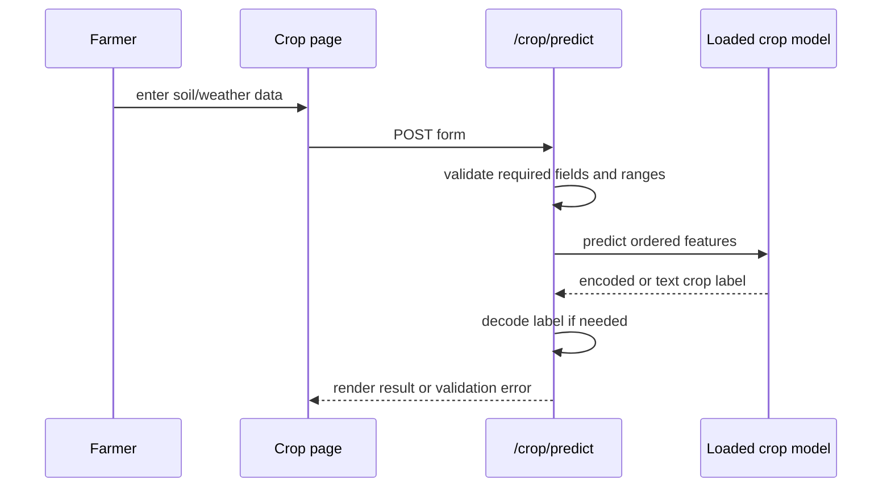

# Application Workflows

## Crop recommendation (synchronous)
1. Farmer opens crop page and enters soil/climate values.
2. Browser posts form values to `/crop/predict`.
3. Crop route requires N, P, K, temperature, humidity, pH and rainfall; it converts and range-checks numeric values.
4. Route uses model and label encoder loaded from model-versioning manager or legacy pickle files.
5. It predicts crop label and renders result template with input parameters/model version. Missing model returns unavailable error; invalid values return form with error.

## Yield prediction
GET `/yield/` asks the initialized YieldPredictionService for valid crop/season/state choices and renders `yield_prediction.html`. At startup the service looks for a joblib bundle containing model, encoders, scaler and feature schema. POST `/yield/predict` validates numbers/categories, encodes categories, arranges feature columns, scales as trained and predicts; missing bundle returns 503, invalid form returns 400 and unexpected error logs then shows generic failure.

## Disease image workflow
`disease.html`/`disease.js` reads selected photo, creates a resized JPEG data URL and POSTs to `/api/v1/ai-disease/predict-trained`. Server verifies base64, size and supported crop, converts image to RGB 256x256 tensor, applies same [0,1] preprocessing used by its notebook, gets CNN logits, applies softmax and returns top prediction/alternatives. UI now gates low/ambiguous raw scores as uncertain; it does not certify disease. Authenticated `/analyze` is a separate service path that may save a diagnosis; incident reporting is another API.

## Fertilizer, irrigation and rotation
Fertilizer: authenticated role-restricted JSON POST to `/api/recommend/fertilizer` → parse soil pH/crop/stage/weather → `agri_utils.recommend_fertilizer` → JSON. Irrigation and rotation use separate Blueprints under server Routes. Their input/output contracts are endpoint specific; there is no assumed automatic pipeline from crop recommendation.

## Authentication
Registration/login forms send credentials to auth routes; service checks account and hash, persistence writes user metadata and route returns result/tokens. Protected calls are decorated; failed/missing token gets an auth error. Role checks further limit actions. Frontend token storage varies and should be traced in `auth.js`.

## Async task
Crop task route authenticates/authorizes, checks required fields, enqueues Celery task, returns 202/task ID. The browser polls status route. Worker computes and state is surfaced as pending, processing, completed/result or failed. Redis and worker availability are required.

## Market prices and other services
Price tracker Blueprint includes market/state lookup, forecast, profit optimization, heatmap and alert subscription. Trace each specific page to route and service before assuming data freshness, persistence or external provider. API v1 includes many additional module families; route appendix is a navigation index, not a claim that all are production ready.
